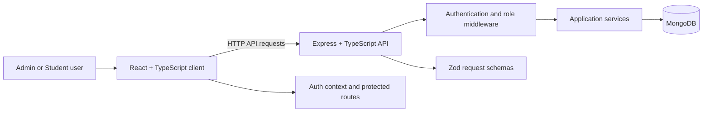

# System Architecture

**Project:** Role-Based CRUD Application  
**Status:** Draft aligned with the current BRD, SRS, FRD, and project context

## 1. Purpose

This document describes the application's major components, their responsibilities, and the boundaries between them. It reflects the currently agreed architecture; items that depend on open product or security decisions are called out as TBD.

## 2. Architectural Overview

The system uses a client-server architecture:

- **Client:** React with TypeScript. Presents authentication and role-specific workflows, manages UI state, and calls the API through shared service modules.
- **API:** Node.js and Express with TypeScript. Validates requests, authenticates users, authorizes operations by role, runs application services, and returns consistent responses.
- **Database:** MongoDB. Persists user accounts and student records as distinct models.

The API is the security boundary. Frontend route guards improve navigation but do not grant access or replace backend authorization.

## 3. Container Responsibilities

### 3.1 React Client (`client/`)

- `pages/auth/`: Login and registration pages.
- `pages/admin/`: Admin dashboard and student list, create, details, and edit pages.
- `pages/student/`: Student dashboard and profile pages.
- `layouts/`: Role-specific application shells.
- `routes/`: Route registration, authentication protection, and role gating.
- `services/`: Shared API client plus authentication and student API methods.
- `context/` and `hooks/`: Authenticated-user/session state and access to it.
- `components/`: Shared and role-specific UI components.
- `types/` and `utils/`: Client-side contracts, storage helpers, and shared constants.

The client should not implement business authorization as its source of truth. It should use the authenticated identity returned by the API to select navigation and routes, and handle API errors, loading, empty, and mutation states.

### 3.2 Express API (`server/`)

- `app.ts` and `server.ts`: Configure middleware, mount routes, connect infrastructure, and start/stop the server.
- `routes/`: Define authentication and student HTTP endpoints.
- `middlewares/`: Authenticate requests, enforce roles, and normalize errors.
- `schemas/`: Validate request payloads and route inputs with Zod.
- `controllers/`: Translate HTTP requests into service calls and service results into HTTP responses.
- `services/`: Implement authentication and student domain operations.
- `models/`: Define MongoDB persistence models for users and students.
- `config/`: Configure MongoDB connectivity and environment-driven settings.
- `utils/` and `types/`: Shared response/JWT/password helpers and Express request typing.

### 3.3 MongoDB

MongoDB stores two separate, unlinked concepts in the current release:

- **User:** Authentication identity, password hash, and role (`Admin` or `Student`).
- **Student:** Student ID, first name, last name, email, and course/program. Student ID is unique.

Student records are not linked to login accounts. The persistence model must not expose password hashes through API responses.

## 4. Logical Request Flow

For a protected operation:

1. The client API service sends an HTTP request with the agreed authentication credential.
2. Express applies common middleware and routes the request to the relevant module.
3. Authentication middleware verifies the JWT and attaches trusted identity/role information to the request.
4. Role middleware checks whether the identity may perform the operation.
5. A Zod schema validates request parameters and payloads.
6. The controller invokes the application service.
7. The service performs the operation through the appropriate MongoDB model.
8. The controller returns a consistent success response; centralized error middleware handles failures.

The exact middleware order, endpoint paths, status codes, and response envelope will be defined in `api-documentation.md`.

## 5. Authentication and Authorization

- Registration and login are handled by the authentication module.
- Passwords are hashed with bcrypt before persistence and verified during login; plaintext passwords are never stored or logged.
- Successful login issues a JWT with only the identity and authorization claims required by the API.
- Every protected API operation authenticates the caller and enforces authorization on the server.
- Admin-only student management operations require the Admin role.
- Student routes provide the authenticated account's own email and role only; Student users cannot call Admin student-record operations.
- Public registration always creates a Student account. Initial Admin access is created with the one-time `npm run seed:admin -w @rbac/server` command and environment-provided credentials.
- Access tokens expire after one hour by default and are held in tab-scoped session storage. Refresh tokens and server-side revocation are not implemented.

## 6. Data Ownership and Operations

- User authentication records and student business records have separate models and responsibilities.
- Services validate identifiers and enforce domain rules before reads or writes.
- User authentication records and student records are not linked in the current release.
- Admin can create, list, view, and update student records.
- Student record deletion is excluded; the API does not expose a delete operation.

## 7. Cross-Cutting Concerns

### Validation and Errors

- Validate untrusted inputs at the API boundary using Zod.
- Keep client validation for usability, while treating server validation as authoritative.
- Return a consistent error shape for validation, authentication, authorization, missing records, conflicts, and unexpected failures.
- Avoid returning secrets or internal error details to clients.

### Configuration and Secrets

- Load database and JWT configuration from environment variables.
- Commit an `.env.example` containing variable names and safe example values, never real credentials.
- Production API traffic must use HTTPS. CORS policy and other deployment security settings are environment-specific and TBD.

### Testing

- Unit-test schemas, services, and authorization middleware.
- Integration-test auth and student routes against persistence behavior.
- End-to-end-test Admin and Student primary workflows, including attempts to access disallowed operations.

## 8. Deployment View

The intended deployment has three logical runtime resources: a static or hosted React client, a Node.js API service, and a MongoDB database service. They may be deployed independently and configured through environment-specific settings. Hosting provider, network topology, database backup/restore, scaling, monitoring, and availability targets are TBD; this document does not prescribe a vendor or deployment topology.

## 9. Key Architecture Decisions

| Decision | Current direction | Status |
|---|---|---|
| Client/server split | React client calls a separate Express API | Confirmed |
| Language | TypeScript on client and server | Confirmed |
| Persistence | MongoDB with separate User and Student models | Confirmed |
| Authentication | JWT; one-hour default expiration | Confirmed |
| Password handling | bcrypt hashing | Confirmed |
| Request validation | Zod at API boundary | Confirmed |
| Authorization | Enforced by server middleware/services | Confirmed |
| Initial Admin creation | One-time CLI provisioning command | Confirmed |
| Student/user association | Accounts and records remain separate | Confirmed for current release |
| Student fields | Student ID, first/last name, email, course/program | Confirmed; student ID unique |
| Student deletion | Not available in current release | Deferred |

## 10. Related Documents

- [Business Requirements Document](brd.md)
- [Software Requirements Specification](srs.md)
- [Functional Requirements Document](frd.md)
- [Project context](project-context.md)
- [Implementation plan](implementation-plan.md)
